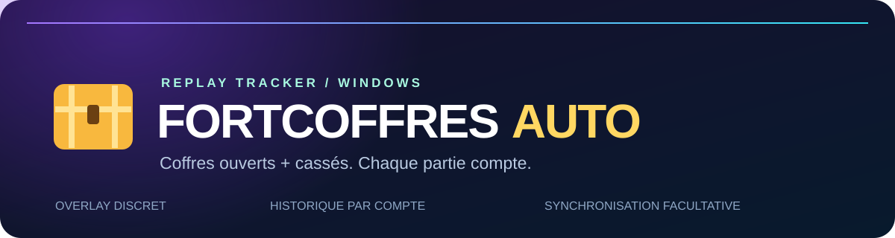
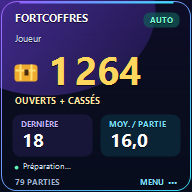

<div align="center">



# Tes coffres. Tes parties. Tout au même endroit.

**Un compteur automatique pour Fortnite, dans un petit overlay Windows.**


[](https://github.com/guestop89/chest-opener-fortnite/actions/workflows/windows.yml)

[**Télécharger pour Windows**](https://github.com/guestop89/chest-opener-fortnite/releases/latest) · [Installation](#installation) · [FAQ](#questions-fréquentes) · [Signaler un problème](https://github.com/guestop89/chest-opener-fortnite/issues)

</div>

---

## Un petit carré, trois chiffres utiles

FortCoffres lit les fichiers `.replay` enregistrés par Fortnite sur ton PC et met à jour tes statistiques **après chaque partie terminée**.

<div align="center">

<br><sub>Aperçu de l’interface avec des données fictives.</sub>
</div>

| Indicateur | Ce qu’il affiche |
| --- | --- |
| **Total** | Tous les coffres des parties analysées pour le compte sélectionné. |
| **Dernière partie** | Les coffres de la dernière partie terminée. |
| **Moyenne** | Les coffres par partie analysée, y compris les parties à zéro. |

### Ce que tu peux faire

- **Compter les coffres ouverts et cassés** : les destructions attribuées à ton joueur dans le replay sont incluses par défaut.
- **Rattraper les replays présents sur le PC** : l’application reprend les fichiers encore disponibles à son lancement.
- **Retrouver chaque partie** : date, coffres, mode et classement dans l’historique.
- **Séparer les comptes** : les parties sont regroupées par identifiant Epic quand il est disponible.
- **Synchroniser plusieurs PC** : fusion des historiques dans un dossier partagé de ton choix, sans doublon de partie.
- **Personnaliser le fond** : ajoute ta propre photo localement, affichée à 50 % d’opacité.

> **À savoir :** ce n’est pas un compteur instantané pendant les ouvertures. Fortnite finalise généralement la clé de lecture du replay à la fin de la partie.

## Installation

1. Télécharge le fichier **FortCoffresAuto-windows-x64.zip** dans les [Releases](https://github.com/guestop89/chest-opener-fortnite/releases/latest).
2. Extrais le ZIP dans un dossier où tu peux enregistrer des fichiers.
3. Dans Fortnite, active **l’enregistrement des rediffusions/replays** dans les paramètres de jeu.
4. Lance **FortCoffresAuto.exe** et laisse-le ouvert pendant tes parties.
5. Pour voir l’overlay au-dessus du jeu, utilise le mode **Plein écran fenêtré**.

La version distribuée inclut .NET : tu n’as pas besoin d’installer le SDK pour jouer.
Le premier import peut prendre quelques minutes si tu as beaucoup de replays. La progression s’affiche dans le carré.

Le dossier détecté automatiquement est :

```text
%LOCALAPPDATA%\FortniteGame\Saved\Demos
```

Tu peux le changer dans le menu de l’application.

## Commandes

| Action | Commande |
| --- | --- |
| Ouvrir le menu | Clic droit sur le carré ou son icône près de l’horloge |
| Déplacer le carré | Glisser le titre quand il est déverrouillé |
| Afficher / masquer | **Ctrl + Maj + O** |
| Verrouiller / déverrouiller | **Ctrl + Maj + L** |
| Ajouter une photo | Menu → **Choisir une photo de fond…** |
| Voir les parties | Menu → **Historique des parties…** |

Une fois verrouillé, l’overlay laisse passer la souris vers le jeu.

## Synchroniser entre PC

Choisis **Synchroniser entre PC…** dans le menu, puis sélectionne sur chaque PC un même dossier déjà partagé par ton logiciel de synchronisation, par exemple OneDrive ou Dropbox.

FortCoffres crée un fichier d’historique par installation et fusionne les parties à partir du **compte + identifiant de session**. Copier deux fois le même historique ne doit pas ajouter deux fois les coffres.

La synchronisation est **facultative et désactivée au départ**. Le transfert est assuré par ton logiciel de synchronisation, pas par une connexion Epic. Le fichier partagé contient les statistiques, pseudos et identifiants présents dans les replays ; choisis un dossier privé.

Tu peux aussi utiliser **Exporter l’historique…** puis **Importer un historique…**.

## Questions fréquentes

<details>
<summary><strong>Est-ce le total à vie de mon compte Epic ?</strong></summary>

Non. Le total couvre les replays analysés. Les anciennes parties dont les fichiers ont été supprimés ne peuvent pas être récupérées automatiquement depuis ton compte Epic. Les parties déjà enregistrées par FortCoffres restent conservées même si Fortnite supprime leurs replays plus tard.

</details>

<details>
<summary><strong>Les coffres cassés sont-ils comptés ?</strong></summary>

Oui, par défaut, lorsque le replay attribue la destruction à ton joueur. Cela peut inclure une pioche, une explosion ou la destruction du support. Une action non attribuée dans le replay ne peut pas être reconstruite avec certitude. Le menu permet de désactiver leur inclusion ; total, dernière partie et moyenne suivent le même réglage.

Les boîtes de munitions, la nourriture et les canons à butin restent séparés du total des coffres. Les ouvertures des coéquipiers ne sont pas ajoutées à ton total.

</details>

<details>
<summary><strong>Pourquoi une partie manque-t-elle ?</strong></summary>

Vérifie que les replays sont activés et que le fichier existe encore. Les parties créatives ou les replays incomplets peuvent être ignorés. Un changement du format des replays après une mise à jour de Fortnite peut aussi nécessiter une mise à jour du lecteur. Le journal `errors.log` aide à comprendre les replays illisibles.

</details>

<details>
<summary><strong>L’application modifie-t-elle le jeu ?</strong></summary>

Le compteur ouvre les replays en lecture seule. Il ne lit pas la mémoire du processus Fortnite et n’injecte rien dans le jeu. Cela ne constitue pas une certification ni une garantie d’approbation par Epic Games.

</details>

<details>
<summary><strong>Où sont mes données et ma photo ?</strong></summary>

Dans le dossier `FortCoffresAuto-data` à côté de l’EXE. Garde-le si tu déplaces l’application. Les fichiers `.bak` conservent les sauvegardes précédentes.

Ta photo de fond reste locale et n’est pas ajoutée aux fichiers de synchronisation. La distribution publique ne contient aucune photo personnelle, aucun replay et aucun historique réel de joueur.

</details>

## Compiler depuis les sources

Prérequis : **Windows x64** et le [SDK .NET 10](https://dotnet.microsoft.com/download/dotnet/10.0).

```powershell
dotnet publish src/FortCoffresAuto/FortCoffresAuto.csproj -c Release -r win-x64 --self-contained true -p:PublishSingleFile=true -p:IncludeNativeLibrariesForSelfExtract=true -p:EnableCompressionInSingleFile=true -p:DebugType=none -o dist
```

L’exécutable est créé dans `dist/FortCoffresAuto.exe`.

Pour exécuter les vérifications de calcul, déduplication, profils, persistance et fusion :

```powershell
./dist/FortCoffresAuto.exe --self-test --data ./test-results
```

Le [workflow Windows](.github/workflows/windows.yml) compile le projet, exécute les vérifications et publie la version indiquée dans le projet lors d’une mise à jour de `main`. Les pull requests compilent et testent sans publier de release.

## Crédits et licence

Ce projet adapte le lecteur de [LED-N/Fortnite-ChestCounter](https://github.com/LED-N/Fortnite-ChestCounter), lui-même basé sur [Shiqan/FortniteReplayDecompressor](https://github.com/Shiqan/FortniteReplayDecompressor). Les modifications du lecteur sont décrites dans [lib/PATCHES.md](lib/PATCHES.md).

Interface compacte, historique par compte, thème coloré et fusion entre PC : adaptation maintenue sous le compte **guestop89**.

Code sous [licence MIT](LICENSE). Les notices tierces sont conservées dans [THIRD_PARTY_NOTICES.md](THIRD_PARTY_NOTICES.md).

**Projet indépendant, non affilié, approuvé ou sponsorisé par Epic Games. Fortnite est une marque d’Epic Games.**
